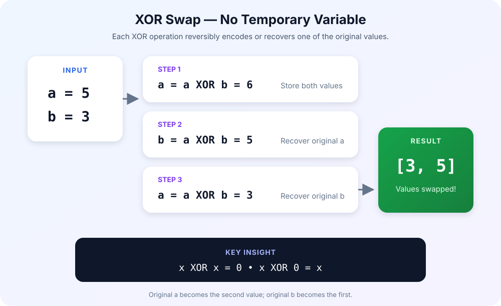

# Swap Two Variables

[](https://www.tutorialspoint.com/practice/swap-two-variables.htm)


> Source: [TutorialsPoint — Swap Two Variables](https://www.tutorialspoint.com/practice/swap-two-variables.htm)

## Problem Statement

Write a program to **swap two variables without using a third variable**.

Given two integers `a` and `b`, exchange their values without creating an
additional temporary variable. Return the swapped values as an array `[b, a]`,
where `a` and `b` are the original input values.

## Input and Output

### Example 1 — Basic Swap

```text
Input:  a = 5, b = 3
Output: [3, 5]
```

The original value of `b` becomes the first element, and the original value of
`a` becomes the second element.

### Example 2 — Negative Numbers

```text
Input:  a = -2, b = 7
Output: [7, -2]
```

The same approach works when either value is negative.

### Example 3 — Equal Values

```text
Input:  a = 4, b = 4
Output: [4, 4]
```

Swapping equal values leaves the result unchanged.

## Constraints

- `-10^9 <= a, b <= 10^9`
- Do not use a temporary variable.
- Return `[b, a]`, using the original values of `a` and `b`.

## XOR Approach

The bitwise XOR operator (`^`) can encode both values in one variable and then
recover each original value:

```text
a = a ^ b
b = a ^ b
a = a ^ b
```

After these three operations, `a` contains the original value of `b`, and `b`
contains the original value of `a`.



### Why It Works

XOR has two useful properties:

```text
x ^ x = 0
x ^ 0 = x
```

For the inputs `a = 5` and `b = 3`:

1. `a = 5 ^ 3 = 6`
2. `b = 6 ^ 3 = 5` — recovers the original `a`
3. `a = 6 ^ 5 = 3` — recovers the original `b`

The function can then return `[a, b]`, which is `[3, 5]`.

## Pseudocode

```text
function swap(a, b):
    a = a XOR b
    b = a XOR b
    a = a XOR b
    return [a, b]
```

## Complexity

- **Time:** `O(1)`
- **Extra space:** `O(1)`
